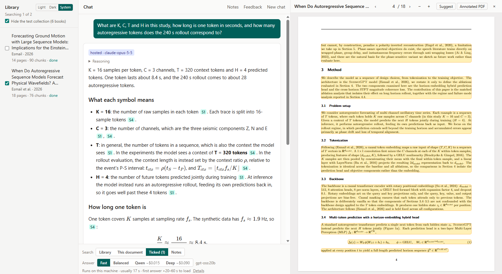
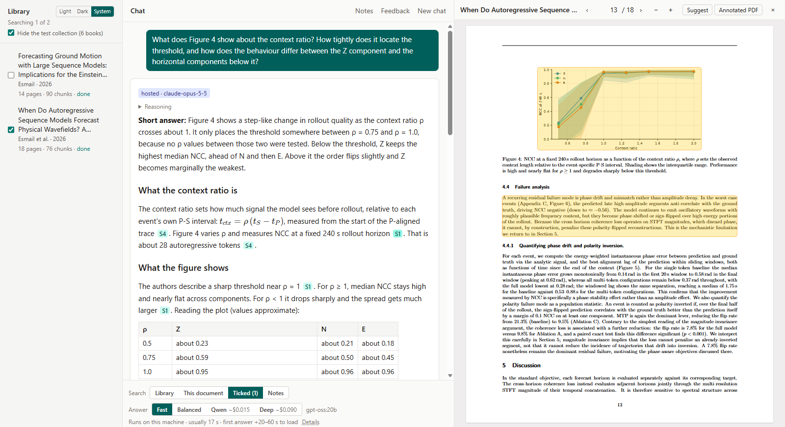
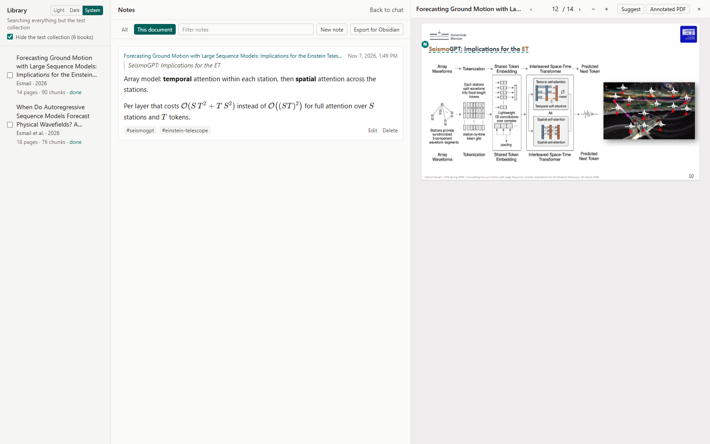

# Study assistant

A study assistant for physics, maths and code that answers from **your own** books, papers and slide decks, and cites the exact page. Click a citation and the page opens beside the answer, with the passage highlighted. It runs on your own machine with one 16 GB NVIDIA GPU. Each question can stay local, or go to a hosted model (Claude through the Anthropic API, or Qwen through OpenRouter) when you choose one for it. It is a research tool, built and measured by one person for their own study, not a product.


*An answer from Deep about the author's own arXiv paper. Citations such as S1 and S4 open the page, with the cited passages highlighted.*


*A figure question: Deep reads the values off Figure 4 (it gets the image itself) and cites the page.*


*Notes in Markdown with LaTeX, anchored to a passage (the N marker on the slide), with tags and an Obsidian export.*

The documents in the screenshots are the author's own paper ([arXiv 2606.10868](https://arxiv.org/abs/2606.10868), CC BY 4.0) and a conference talk of theirs.

## What makes it different

- **Page-exact citations.** Answers cite numbered sources, and a source opens its page with the passage highlighted. Citations to sources the model wasn't given are removed while the answer streams.
- **Formulas.** Display equations are read by a vision model from the page image, then checked against the PDF's own glyphs. A formula that fails the check is never shown as clean LaTeX: you see the crop from the page, flagged, and the model gets the symbols with a warning. On 100 sampled book equations, 96 were shown correctly and 2 were wrong without a warning.
- **Figures.** Figures are searchable by caption and by an AI-written description, made only after you agree to the cost (under 1 cent a figure). Deep and Balanced also see the figure image itself.
- **Local or hosted, per question.** Choose Fast, Balanced, Qwen or Deep above the question box. A hosted choice applies to that one question, and every answer carries a badge naming the model that actually wrote it.
- **SymPy checks.** With **Check** on, the answer ends with its claims in SymPy form (identities, derivatives, integrals, limits, numbers with units), and each claim is checked in a sandbox. The badge says "N of M checked claims passed", never "correct".
- **Measured quality.** The model choices and the main design decisions were graded blind on a fixed set of 35 questions with written key points. The numbers are below; the full record of runs and grades stays in the author's private research repository.

Also: PowerPoint decks (with speaker notes), web search for Deep and Qwen, tools that run Python and write Markdown, PDF, Word and PowerPoint files in a container, line-by-line Explain for equations and code, highlights and notes, and daily backups.

## Requirements

| | |
|---|---|
| Operating system | Windows 11 with WSL2 (tested: Ubuntu 26.04 under WSL2). Native Linux should work from INSTALL.md's step 2 on, but hasn't been tried. No macOS. |
| GPU | NVIDIA with **16 GB**, with the Windows driver (no Linux driver inside WSL). Tested on an RTX 4090 Laptop GPU. There is no mode without a GPU. |
| RAM | Tested with 48 GB in the machine, WSL capped at 36 GB plus 8 GB swap. Less hasn't been tested. |
| Disk | About **30 GB** inside WSL: the required local models 16 GB, the parser and reranker models 4 GB, Python packages 6.6 GB, Docker images 2.1 GB. The optional local models add 32 GB (Balanced 15 GB, the summary model 17 GB). Your library comes on top: 8 documents (about 800 pages) take 0.4 GB. |
| Docker | Docker Engine inside WSL (`docker.io`). Docker Desktop isn't needed. |
| Network | For setup, about 30 GB of downloads. After that, only for hosted answers, web search, and the parser models the first time a document is added. |
| Accounts | None for the local modes. Your own Anthropic key for Deep; your own OpenRouter key for Qwen (optional). |

## Quick start

> **INSTALL.md hasn't yet been tested on a fresh machine.** It was written and checked on the author's own setup, which grew over several weeks, but nobody has followed it from an empty WSL distribution yet. As an early user you may hit gaps: a missing package, a step out of order, a command that needs changing. Please report each one (see [Feedback and support](#feedback-and-support)), with the step and the exact error, so it can be fixed for the next person.

The full steps, with the checks after each, are in **[INSTALL.md](INSTALL.md)**. In short:

```bash
# Windows PowerShell:  wsl --install -d Ubuntu-26.04   (then work in Ubuntu)
sudo apt install -y git curl build-essential python3.14 python3.14-venv docker.io docker-buildx
sudo usermod -aG docker "$USER" && sudo systemctl enable --now docker   # then open a new terminal

curl -fsSL https://ollama.com/install.sh | sh
ollama pull gpt-oss:20b && ollama pull bge-m3 && ollama pull qwen3:1.7b

git clone https://github.com/wesmail/study-assistant-share.git study-assistant && cd study-assistant
python3.14 -m venv .venv && .venv/bin/pip install -r backend/requirements.txt
scripts/build_sandbox.sh && scripts/build_office.sh
docker pull searxng/searxng:2026.10.19-81371861f

# config.yaml: set backup_dir (backups are off until you do), check office_fonts_dir (INSTALL.md, step 6)
cp ~/some-paper.pdf library/
scripts/start.sh                     # then open http://localhost:8000
```

`scripts/smoke.sh` then checks the install for free: it ingests a small PDF and a deck in a scratch folder, asks Fast one question that must cite page 2, and runs code and SymPy in the sandbox.

**Setup time: not yet measured from zero.** Most of it is downloading about 30 GB. At 100 Mbit/s that alone takes about 40 minutes, and the image builds and first parse add more, so plan for an afternoon. The first document you add also downloads the parser's models (4 GB).

## Accounts and costs

The local modes, Fast and Balanced, are free and need no account. Hosted modes bill **your own** account:

- **Deep** needs an Anthropic API key, from the Anthropic Console.
- **Qwen** needs an OpenRouter key, from openrouter.ai. It's optional.

Put the keys in `.env` in the project folder (INSTALL.md, step 6). The app reads them only from that file, never from the environment, and never prints, logs or backs them up with the data.

**Never share a key, and never use someone else's.** Each person runs on their own key and pays for their own questions. A key in a chat, an e-mail or a commit has to be revoked in the console.

| Mode | Typical cost per question | Measured on |
|---|---|---|
| Fast, Balanced | free | |
| Qwen | $0.015 on average, at most $0.031 | the 35 gold questions, Nov 2026 |
| Deep | **$0.14** on average, at most $0.30 | the 35 gold questions as the app asks them, Nov 7, 2026 |
| Deep with web search | $0.18 on average, at most $0.27 | the 11 web questions, Nov 2026 |
| Explain (an equation) | about $0.04 | 10 calls |
| Figure descriptions | about $0.01 a figure, asked before it runs | 401 figures |

Thinking is billed as output, so a hard derivation costs more than a lookup, and a long chat sends more input. Prices are in `config.yaml`, with the date each was checked. Each hosted answer shows its own cost, and the selector shows this month's hosted spend.

**Set a spending limit in each console.** That limit is what actually stops calls; the app only displays spend.
- **Anthropic:** set a monthly spend limit on the workspace the key belongs to.
- **OpenRouter:** give the key a credit limit when you create it.

The figure in `config.yaml` (`hosted_monthly_limits`) is only shown beside the month's spend. Set it to your own limit.

## The four answer modes

| Mode | Model, where | Good answers, 35 gold questions | Figure questions | Median time | Cost |
|---|---|---|---|---|---|
| **Fast** (default) | gpt-oss 20B, this machine | 12 of 35 | not measured | 17 s | free |
| **Balanced** | Gemma 4 26B-A4B, this machine | 18 of 35 (16 of 20 on the textbook questions) | 1 of 10 | 62 s | free |
| **Qwen** | Qwen3.8 27B, OpenRouter (DeepInfra only) | 26 of 35 | not measured | 188 s | ~$0.015 |
| **Deep** | Claude Opus 5.5, Anthropic | **34 of 35** | **9 of 10** | 25 s | ~$0.14 |

The 35 gold questions are 20 about four textbooks and 15 about a 2026 paper. A blind grader rates each answer good, weak or wrong against written key points.
- Deep and Balanced were graded together in the final evaluation (Nov 7, 2026), answering as the app does.
- Fast and Qwen are from an earlier round (Nov 3, 2026), answering without tools. Graders differ by up to about 3 answers between rounds, so compare those two only roughly.

**Which mode to use:**
- **Figures and code: Deep.** Balanced reads figures but leaves out the values the question asks for (1 of 10 good). On the 22 tool tasks (running code, making files), Deep passed 22, Balanced 17 and Fast 16.
- **Private textbooks you'd rather not send out: Balanced.** It got 16 of the 20 textbook questions right (Deep 20 of 20), nothing leaves the machine, and it costs nothing.
- **Anything newer than the models' training data, such as a recent paper: Deep.** On the 15 paper questions, Deep got 14 and Balanced 2.
- **Fast** answers a quick lookup in about 17 s. It is weaker on derivations, and it leaves out citations in about 1 answer in 10, saying so when it does.
- **Qwen** costs a tenth of Deep, but it is slow, and 3 of the 35 questions ran out of thinking room with no answer. The app then offers to ask again in Deep; it never switches model by itself.

Only one local model fits in 16 GB, so switching between Fast and Balanced reloads it, which takes 20–60 s.

## Privacy: what leaves your machine

- **Fast and Balanced:** nothing. The models, search, parsing and the sandbox all run locally.
- **Qwen and Deep** send, for that one question:
  - the question, and the passages found for it;
  - your previous question and its answer, with the passages that answer cited;
  - what tools return (more passages, code output, SymPy results).

  Qwen goes to OpenRouter, pinned to DeepInfra, and never to a provider that keeps or trains on prompts. Deep goes to Anthropic; if Opus fails, the same request goes to Claude Sonnet 5.5, and the badge says so.
- **Explain on an equation, and Suggest,** always use Deep, whatever mode is chosen: they send Anthropic the equation with its page's text, or the up to 10 pages you choose. Explain on code uses Balanced, locally, when Balanced is the chosen mode, and Deep otherwise.
- **Figure descriptions** send each figure's image and its page's text to Anthropic, only after you accept the cost in the library pane.
- **Web search** is offered only in Deep and Qwen, and only for a question with **Web** on, or after you click a search the model proposed.
  - The search terms go through a local SearXNG to public search engines: Google, Qwant, Yahoo, Seznam, Mojeek, Startpage and others.
  - Pages are fetched from your machine, so those sites see your IP address.
  - The page text then goes to the hosted model.
- **Never sent:** your files themselves, older turns of the chat, notes that weren't found for the question, your keys, and pages you exclude. List pages under `exclude_pages` in `library/metadata.yaml`, for a CV slide say, and they are never searched or sent anywhere.

Feedback, notes, highlights and the chat history stay in `data/` on your machine. Details are in [ARCHITECTURE.md](ARCHITECTURE.md#trust-boundaries).

## Using it

- **Add documents:** click **Add PDF or deck…** at the top of the library pane, or copy PDFs or `.pptx` decks into `library/` yourself. The button never replaces a file that is already there, and refuses a document already in the library under another name; up to 200 MB a file (`upload_max_bytes`). From Windows, that folder is `\\wsl.localhost\Ubuntu-26.04\home\<you>\study-assistant\library`. The app picks them up while running; the library pane shows each document's stage, and a document is searchable once it's indexed. Parsing uses the GPU, so local answers run slower meanwhile: add books overnight, or use Deep while they parse.
- **Remove documents:** **Remove…** under a document moves its file to `library/.removed/`. It leaves search at once, and its index, highlights and notes are kept, so **Restore** brings it back as it was, with nothing parsed again. **Empty removed files…** at the bottom of the library pane is the only step that deletes: the files, then the index of their documents. It shows what goes first, and notes are always kept.
- **Titles and kept-out pages:** a title comes from the file's metadata or its first page, never from the file name. Correct it in the library pane, which writes `library/metadata.yaml`. You can also edit that file:
  ```yaml
  my-talk.pptx:
    title: "Lectures on quantum field theory"
    author: "A. Author"
    year: 2026
    exclude_pages: [1]      # never searched, never sent to a hosted model
  ```
- **Search scope:** under the question box, **Library** searches everything, **This document** the one open in the viewer, **Ticked** the documents ticked in the library, and **Notes** your notes only.
- **Check:** turn it on for the next question to have its claims checked with SymPy. It's best with Deep; Fast and Balanced write few checkable claims, and their badge says so.
- **Web:** in Deep or Qwen, turn on Web for one question. Web sources are cited as [Web n], with their links.
- **Highlights and notes:** select text in the viewer for **Ask about this**, **Highlight**, **Explain** or **Add note**. Notes are Markdown with `$…$` maths and tags, and answers can cite them as sources. **Suggest** in the viewer's header proposes highlights from any instruction ("highlight the key definitions"), for you to accept or reject. **Annotated PDF** writes a copy with your highlights and notes; the original is never changed.
- **Obsidian:** **Notes → Export for Obsidian** downloads a zip with one Markdown file per document.
- **Feedback:** 👍 or 👎 under any answer, with an optional note, saves the whole turn (question, answer, model, sources) to the review list behind **Feedback**. It stays on your machine; see below for how to send it on.
- **Backups:** `scripts/backup.sh create` makes one now, and `scripts/backup.sh install-timer` makes one daily. Each holds the database, your notes and highlights, the parsed pages and your library. Set `backup_dir` in `config.yaml` first, on another drive if you can. `.env` is never in an archive; its copy is kept under `~/backups`. Listing, verifying, copying to an external drive and restoring are in [INSTALL.md](INSTALL.md#9-backups-optional).

When something fails, start with `scripts/smoke.sh`, then [TROUBLESHOOTING.md](TROUBLESHOOTING.md).

## Known limitations

- **Local models on hard questions.** On the gold derivations, Fast and Balanced each got 4 of 10 good, against Deep's 10 of 10. On figure questions, Balanced got 1 of 10. On a paper newer than their training data, Balanced got 2 of 15 and Fast 0 of 15.
- **Inline maths** is often garbled by the parser: about 2 of 15 sampled inline formulas came out right. Display equations are much better (96 of 100 shown correctly), and about 2 in 100 are misplaced without a warning, such as `h_{1:2}` read as `h_1 : 2`. The viewer always shows the original page.
- **Slides:** text boxes are read top to bottom, left to right, so a label and its value in separate boxes can still pair up wrongly. The local summaries can also flatten details that differ between slides.
- **Only trusted PDFs.** Library PDFs are parsed on the host by native code (PyMuPDF, Docling), not in the sandbox. Add only files from sources you trust. Decks are rendered in a container.
- **Fresh install not yet tested.** INSTALL.md hasn't been followed from an empty WSL distribution. Its apt and Ollama installs, model pulls and image builds weren't run as written, and the author's Python environment came from micromamba, not from Ubuntu's `python3.14-venv`. Expect a rough edge or two, and please report them.
- **One machine, one user.** It was tested on one laptop. It listens only on localhost and has no log-in, so don't expose port 8000.
- **Web search** depends on public search engines, which rate-limit bursts. The local models have no web search: Fast followed an instruction planted in a test page in some runs, so web stays off for them.
- **No GPU, no app.** There is no hosted-only mode.

## Licence

The code is under the **GNU Affero General Public License v3.0** ([LICENSE](LICENSE)). It uses PyMuPDF, which is AGPL. In short:
- You may use, study, change and share it.
- If you give a changed version to others, or let others use it over a network, you must offer them its source under the same licence.
- It comes with no warranty.

**No books or documents ship with the repository.** You bring your own, and you are responsible for having the right to use them. `library/` and `data/` are git-ignored, except `library/metadata.yaml`, which holds titles and settings, no content.

## Feedback and support

This is a research tool, maintained by one person, not a supported product. Reports are welcome:
- **Problems and ideas:** open a GitHub issue in this repository. Say what you did, what happened, the mode, and what `scripts/smoke.sh` printed.
- **A bad answer:** rate it 👎 with a note, then copy the entry from the **Feedback** list into an issue. The feedback list never leaves your machine by itself.
- **Leave out of issues:** keys, and text from books you can't share.

How it fits together: [ARCHITECTURE.md](ARCHITECTURE.md).
